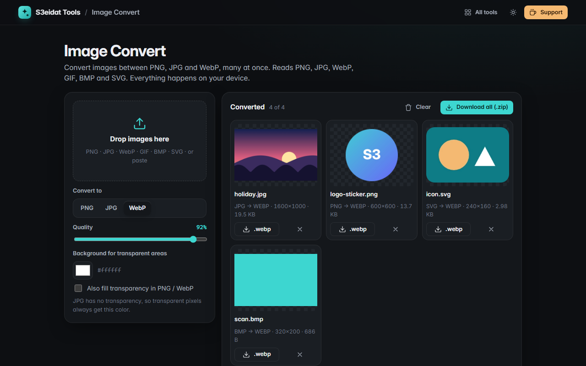

# Image Convert

> Convert images between PNG, JPG and WebP, in bulk. Free, private, and it runs entirely in your browser.

### ▶ [Open Image Convert](https://s3eidat.github.io/image-convert/)



## Features

- **Reads** PNG, JPG, WebP, GIF (first frame), BMP and SVG, plus anything else your browser can open
- **Writes** PNG, JPG and WebP (and AVIF if your browser can encode it)
- **Quality** slider for JPG / WebP / AVIF
- **Background color** for transparent areas when converting to JPG, optionally for PNG / WebP too
- SVGs render at their own size (width/height or viewBox) through a sandboxed ``, so scripts inside never run
- **Batch**: convert many files at once, change the format and everything re-converts
- Download one file or **everything as a .zip**

Note: conversion goes through your browser's canvas, so metadata (EXIF, GPS) is not carried over.

## Privacy


Your images never leave your device. There is no server, no account, no analytics.
The page ships with a strict Content-Security-Policy (`connect-src 'self'`), so the browser
itself blocks any attempt to send data anywhere.

## Run it yourself

It's plain HTML, CSS and JavaScript with no build step:

```bash
git clone https://github.com/s3eidat/image-convert
cd image-convert
python -m http.server 8000
```

Then open http://localhost:8000.

## Support

If this saved you time, **[buy me a coffee ☕](https://s3eidat.github.io/coffee/)**. It keeps every tool free.

---

Part of **[S3eidat Tools](https://s3eidat.github.io/)**: 100+ free, private tools that run in your browser. MIT licensed.
